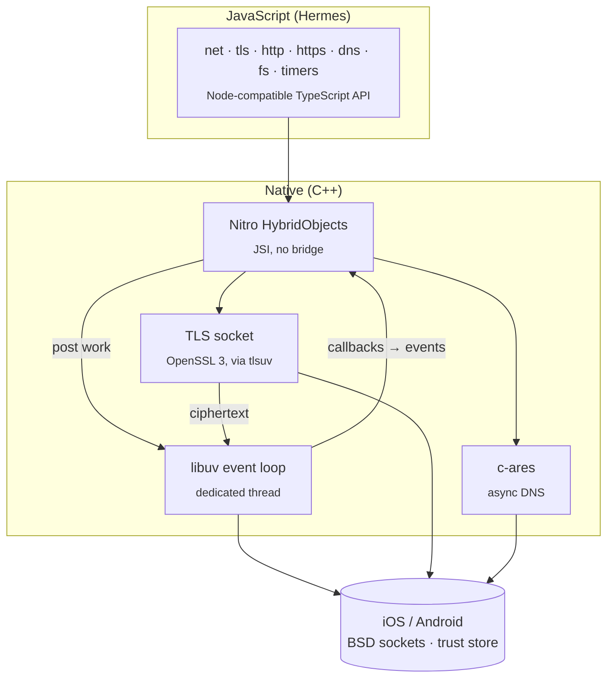

<div align="center">

# react-native-nitro-node

**Node.js core modules for React Native, running on a real libuv event loop.**

`fs` · `net` · `tls` · `dns` · `http` · `https` · `events` · `stream` · `timers` · `querystring` · `buffer` · `os` · `path` · `process`

[](https://www.npmjs.com/package/react-native-nitro-node)
[](./LICENSE)


</div>

---

Write networking and file system code for React Native the way you would for Node.js: open raw TCP sockets, run an HTTP server on the device, resolve DNS names, or read and write files. The APIs are the ones you already know from Node.

```ts
import net from 'react-native-nitro-node/net';

const server = net.createServer((socket) => {
  socket.write('hello from your phone 👋\n');
  socket.pipe(socket); // echo
});

server.listen(8080, '0.0.0.0', () => {
  console.log('listening on', server.address());
});
```

Underneath is **[libuv](https://libuv.org)**, the same C library behind Node.js's own event loop, and **[OpenSSL](https://www.openssl.org)** for TLS, like in Node. The library compiles them into your app and exposes them to JavaScript through **[Nitro Modules](https://nitro.margelo.com)**, with direct JSI bindings and no bridge.

## ✨ Features

- 🔌 **Real TCP sockets and servers:** `net.Socket` and `net.Server` are backed by libuv `uv_tcp_t` handles, not by a WebSocket or a platform HTTP stack.
- 🌐 **HTTP client and server:** an `http` module with streaming bodies, chunked encoding, keep-alive and upgrade/CONNECT events.
- 🔒 **Native TLS client:** TLS 1.2 and 1.3 sockets and `https` requests on **OpenSSL 3**, with certificate verification against the system's trust store, SNI and ALPN. Encryption runs on the native side; JavaScript only sees plaintext. *(See the [security notes](#-security-notes).)*
- 📁 **File system:** `fs` with files, file descriptors, directories, `stat` and `statfs`, in callback and `*Sync` forms. The callback forms run off the JS thread.
- ⏱️ **Timers that keep running in the background:** `setTimeout`, `setInterval` and `setImmediate` run on the libuv loop, so they go on while React Native's own timers are paused. `process.nextTick` and the other modules use them too.
- 🧭 **Native DNS:** `dns.lookup` and `dns.resolve*` are powered by **[c-ares](https://c-ares.org)**, which Node also uses.
- 🧵 **Off the JS thread:** all I/O runs on a dedicated libuv loop thread. Results are delivered back to JavaScript as events.
- 📦 **Node-style imports:** every module supports both `import net from '…/net'` and `import { connect } from '…/net'`.
- 🟦 **TypeScript first:** written in TypeScript, with typed event maps (`socket.on('data', (buf) => …)` knows `buf` is a `Buffer`).
- 🧰 **Node-compatible errors:** errors carry Node's `code`, `errno` and `syscall` fields (`ECONNREFUSED`, `ENOTFOUND`, …), mapped from libuv and c-ares.

## 📦 Installation

```sh
npm install react-native-nitro-node react-native-nitro-modules
# or
yarn add react-native-nitro-node react-native-nitro-modules
```

Then install the native code:

```sh
cd ios && pod install
```

Android needs no extra steps; autolinking picks the library up. OpenSSL comes prebuilt with the package for both platforms, so there is nothing else to install.

### Metro

Wrap your Metro config with `withNitroNode`:

```js
// metro.config.js
const { getDefaultConfig, mergeConfig } = require('@react-native/metro-config');
const { withNitroNode } = require('react-native-nitro-node/metro');

const config = {};

module.exports = withNitroNode(mergeConfig(getDefaultConfig(__dirname), config));
```

It makes Node's module names resolve to this library, for your code and for every package you use: `fs`, `net`, `process` and the rest, also as `node:fs` and `fs/`. Packages written for Node then work as they are.

It matters most for `process`. Streams (and so sockets and HTTP bodies) defer their events with `process.nextTick` from the `process` npm package, which runs on React Native's timers, and React Native pauses those while the app is in the background. This library's `nextTick` runs on its own libuv timers, which keep going. Without the redirect everything works while the app is in the foreground, but stream events such as `'end'`, `'finish'` and `'close'` wait until the app comes back.

To redirect only some modules, list them:

```js
module.exports = withNitroNode(mergeConfig(getDefaultConfig(__dirname), config), {
  modules: ['process', 'timers'],
});
```

The names are `buffer`, `dns`, `events`, `fs`, `http`, `https`, `net`, `os`, `path`, `process`, `querystring`, `stream`, `timers` and `tls`, also exported as `MODULES`. To redirect all but some, filter it: `MODULES.filter(name => name !== 'fs')`. Any `resolveRequest` you already have still handles everything else.

> [!NOTE]
> The library contains native code, so it does not work in Expo Go. Use a [development build](https://docs.expo.dev/develop/development-builds/introduction/) instead.

### Requirements

| | Minimum |
|---|---|
| React Native | New Architecture |
| `react-native-nitro-modules` | 0.35 |
| iOS | 15.1 |
| Android | API 23 (Android 6.0) |

## 🚀 Usage

Each module has its own entry point, like Node's built-ins:

```ts
import fs from 'react-native-nitro-node/fs';
import net from 'react-native-nitro-node/net';
import tls from 'react-native-nitro-node/tls';
import dns from 'react-native-nitro-node/dns';
import http from 'react-native-nitro-node/http';
import https from 'react-native-nitro-node/https';
import { EventEmitter } from 'react-native-nitro-node/events';
import { Readable, pipeline } from 'react-native-nitro-node/stream';
import { setTimeout, setImmediate } from 'react-native-nitro-node/timers';
import querystring from 'react-native-nitro-node/querystring';
import os from 'react-native-nitro-node/os';
import path from 'react-native-nitro-node/path';
import process from 'react-native-nitro-node/process';
import { Buffer } from 'react-native-nitro-node/buffer';

// Named imports work too:
import { createServer, Socket } from 'react-native-nitro-node/net';
import { lookup } from 'react-native-nitro-node/dns';
import { readFileSync } from 'react-native-nitro-node/fs';
```

Types that several modules share live at the root:

```ts
import type { ErrnoException } from 'react-native-nitro-node';
```

### File system

```ts
import fs from 'react-native-nitro-node/fs';
import os from 'react-native-nitro-node/os';
import { Buffer } from 'react-native-nitro-node/buffer';

// tmpdir() for scratch files; for files that must persist, a folder inside
// os.homedir(), e.g. `${os.homedir()}/Documents` on iOS or `${os.homedir()}/files` on Android
const dir = os.tmpdir();

fs.mkdirSync(`${dir}/notes`, { recursive: true });
fs.writeFileSync(`${dir}/notes/today.txt`, 'Buy milk\n');
fs.appendFileSync(`${dir}/notes/today.txt`, 'Call mom\n');

fs.readFile(`${dir}/notes/today.txt`, 'utf8', (err, text) => {
  if (err) return console.error(err.code); // e.g. 'ENOENT'
  console.log(text);
});

console.log(fs.readdirSync(`${dir}/notes`)); // ['today.txt']

const stats = fs.statSync(`${dir}/notes/today.txt`);
console.log(stats.isFile(), stats.size, stats.mtime); // true 18 2026-…
fs.statSync(`${dir}/missing`, { throwIfNoEntry: false }); // undefined

// File descriptors, with explicit positions
const fd = fs.openSync(`${dir}/data.bin`, 'w+');
fs.writeSync(fd, Buffer.from([1, 2, 3, 4]));
const head = Buffer.alloc(2);
fs.readSync(fd, head, 0, 2, 0); // <Buffer 01 02>
fs.closeSync(fd);
```

### TCP client

```ts
import net from 'react-native-nitro-node/net';

const socket = net.connect({ host: 'example.com', port: 80 }, () => {
  socket.write('GET / HTTP/1.1\r\nHost: example.com\r\nConnection: close\r\n\r\n');
});

socket.setEncoding('utf8');
socket.on('data', (chunk) => console.log(chunk));
socket.on('end', () => console.log('server closed the connection'));
socket.on('error', (err) => console.error(err.code, err.message)); // e.g. ECONNREFUSED
```

When a host has both IPv4 and IPv6 addresses, `connect` tries each address in turn, like Node's `autoSelectFamily`.

### HTTP server on the device

```ts
import http from 'react-native-nitro-node/http';

const server = http.createServer((req, res) => {
  res.writeHead(200, { 'Content-Type': 'application/json' });
  res.end(JSON.stringify({ method: req.method, url: req.url }));
});

server.listen(3000, '0.0.0.0');
```

### HTTP and HTTPS requests

```ts
import https from 'react-native-nitro-node/https';

https.get('https://example.com/', (res) => {
  console.log(res.statusCode, res.headers['content-type']);

  let body = '';
  res.setEncoding('utf8');
  res.on('data', (chunk) => (body += chunk));
  res.on('end', () => console.log(body.length, 'characters'));
});
```

```ts
import http from 'react-native-nitro-node/http';

const req = http.request(
  { host: 'httpbin.org', path: '/post', method: 'POST', headers: { 'Content-Type': 'application/json' } },
  (res) => res.pipe(myWritable),
);
req.end(JSON.stringify({ hello: 'world' }));
```

### TLS sockets

```ts
import tls from 'react-native-nitro-node/tls';

const socket = tls.connect(443, 'example.com', () => {
  // 'secureConnect': the handshake is done and the certificate was verified
  console.log('authorized:', socket.authorized, 'ALPN:', socket.alpnProtocol);
  socket.write('GET / HTTP/1.1\r\nHost: example.com\r\nConnection: close\r\n\r\n');
});

socket.on('data', (data) => console.log(data.toString()));
socket.on('error', (err) => console.error(err.message)); // e.g. 'certificate verify failed'
```

`servername` (SNI, and the name the certificate must match) defaults to the host. Pass `ALPNProtocols` to negotiate a protocol, and only for testing, `rejectUnauthorized: false` to skip verification:

```ts
tls.connect({ host: '192.168.1.10', port: 8443, servername: 'my-server.local', ALPNProtocols: ['http/1.1'] });
```

### Events

`events` re-exports [`EventEmitter`](https://www.npmjs.com/package/events), the same class the sockets and servers are built on:

```ts
import { EventEmitter } from 'react-native-nitro-node/events';

const bus = new EventEmitter();
bus.on('ping', (n: number) => console.log('ping', n));
bus.emit('ping', 1);
```

### Streams

`stream` re-exports [`readable-stream`](https://www.npmjs.com/package/readable-stream), Node's own streams packaged for other platforms. Sockets, HTTP bodies and requests are these streams, so they combine with your own:

```ts
import { Transform, promises } from 'react-native-nitro-node/stream';
import net from 'react-native-nitro-node/net';

// a shouting echo server
net.createServer(async (socket) => {
  const upperCase = new Transform({
    transform(chunk, _encoding, callback) {
      callback(null, chunk.toString().toUpperCase());
    },
  });
  await promises.pipeline(socket, upperCase, socket);
}).listen(7000);
```

### Query strings

`querystring` is ported from Node's own module, so it encodes exactly like Node:

```ts
import querystring from 'react-native-nitro-node/querystring';

querystring.stringify({ q: 'nitro node', tags: ['tcp', 'tls'], page: 2 });
// 'q=nitro%20node&tags=tcp&tags=tls&page=2'

querystring.escape('a&b=c'); // 'a%26b%3Dc'
```

### Timers

`timers` has Node's `setTimeout`, `setInterval` and `setImmediate`, with their `clear*` functions:

```ts
import { setInterval, clearInterval, setImmediate } from 'react-native-nitro-node/timers';

const poll = setInterval(() => console.log('still running'), 60_000);
// ...
clearInterval(poll);

setImmediate(() => console.log('after the I/O that is already in'));
```

They run on the library's libuv loop, not on React Native's timers, which React Native pauses while the app is in the background. This library's timers keep going for as long as the operating system lets the app run. iOS suspends an app soon after it goes to the background unless it has a background mode or task, and Android may freeze apps in the background; nothing runs in JavaScript then.

The global `setTimeout` and friends stay React Native's: import these where you need them. With [`withNitroNode`](#metro), packages that `require('timers')` get them too.

`setImmediate` runs its callback after the I/O events that are already in, like Node, and not as a microtask, like React Native's own.

### Process

`process.nextTick` defers a callback to after the current code, like Node's:

```ts
import process from 'react-native-nitro-node/process';

process.nextTick((name) => console.log(`hello ${name}`), 'nitro');
```

It runs on the library's `setImmediate`, so it keeps working in the background too; `net`, `http`, `dns` and, with [`withNitroNode`](#metro), streams use it. Like Node's, it comes before timers and before immediates set after it. Unlike Node's, it comes after promise callbacks, after I/O events that are already waiting, and after immediates set before it. The rest of `process` is the [`process`](https://www.npmjs.com/package/process) package's browser stand-in, see [the table](#process-1).

### DNS

```ts
import dns from 'react-native-nitro-node/dns';

dns.lookup('example.com', { all: true }, (err, addresses) => {
  // [{ address: '93.184.215.14', family: 4 }, { address: '2606:2800:…', family: 6 }]
});

dns.resolve4('example.com', (err, addresses) => {
  // ['93.184.215.14']
});

// Not part of Node: give queries a deadline, in milliseconds.
dns.setDefaultTimeout(5000);
```

### Errors

Errors look like Node's, so you can reuse the same error-handling code:

```ts
socket.on('error', (err) => {
  if (err.code === 'ECONNREFUSED') retryLater();
});

dns.lookup('nope.invalid', (err) => {
  err?.code; // 'ENOTFOUND'
  err?.syscall; // 'getaddrinfo'
});
```

## 🧩 Node.js API compatibility

✅ supported · 🟡 partial · ❌ not yet

### `fs`

| API | Status | Notes |
|---|:---:|---|
| `readFile` / `writeFile` / `appendFile` (+ `Sync`) | ✅ | `encoding`, `flag`, `mode`; strings or any `ArrayBufferView`. Like Node, `readFile` refuses files over 2 GiB (`ERR_FS_FILE_TOO_LARGE`) |
| `open` / `close` / `read` / `write` / `ftruncate` (+ `Sync`) | ✅ | Every Node string flag (`'r'`, `'w+'`, `'ax'`, …); `position: null` uses the file offset. 64-bit positions on every platform and ABI, so files past 2 GiB work |
| `mkdir` / `readdir` / `rmdir` / `rm` / `unlink` (+ `Sync`) | ✅ | `mkdir({ recursive })`, `rm({ recursive, force })` |
| `access` / `exists` / `existsSync` | ✅ | |
| `stat` / `lstat` / `fstat` (+ `Sync`) | ✅ | `Stats` with every field, the `*Ms` times with their nanoseconds and as `Date`s, and `isFile()`, `isDirectory()`, `isSymbolicLink()`, …; `throwIfNoEntry`. `birthtime` is the creation time on iOS; Android doesn't record one, so it's `ctime`, as in Node without `statx` |
| `stat({ bigint: true })` / `BigIntStats` | ❌ | Planned; throws a `TypeError` for now |
| `statfs` (+ `Sync`) | ✅ | |
| `constants` | ✅ | The platform's real values; constants a platform lacks are left out |
| `readdir({ withFileTypes })` / `Dirent` | ❌ | Planned |
| `fs.promises` | ❌ | Planned |
| `createReadStream` / `createWriteStream` | ❌ | Planned |
| `rename`, `copyFile`, `symlink`, `chmod`, `watch`, … | ❌ | Planned |

### `net`

| API | Status | Notes |
|---|:---:|---|
| `net.connect()` / `net.createConnection()` | ✅ | `port`, `host`, `family`, `lookup`, `noDelay`, `keepAlive`, `timeout`, `autoSelectFamilyAttemptTimeout` |
| `net.createServer()` | ✅ | `allowHalfOpen`, `pauseOnConnect`, `noDelay`, `keepAlive` |
| `net.Socket` | ✅ | A full `stream.Duplex`: `write`, `end`, `pipe`, `pause`/`resume`, `setEncoding`, `setTimeout`, `setNoDelay`, `setKeepAlive`, `address`, `destroy`, `readyState`, `ref`/`unref`, … |
| `net.Server` | ✅ | `listen`, `close`, `address`, `getConnections` |
| `net.isIP()` / `isIPv4()` / `isIPv6()` | ✅ | |
| Events | ✅ | `connect`, `ready`, `lookup`, `data`, `drain`, `end`, `timeout`, `error`, `close`, `connection`, `listening` |
| IPC / Unix domain sockets | ❌ | |
| `net.BlockList`, `net.SocketAddress` | ❌ | |

### `tls`

| API | Status | Notes |
|---|:---:|---|
| `tls.connect()` | ✅ | TLS 1.2 and 1.3 on OpenSSL. `host`, `port`, `servername`, `rejectUnauthorized` (default `true`), `ALPNProtocols`, plus `net.connect()`'s `family`, `lookup`, `timeout`, … |
| `tls.TLSSocket` | 🟡 | Client side, created by `tls.connect()`. `encrypted`, `authorized`, `alpnProtocol`, `servername`; emits `connect`, then `secureConnect` |
| Certificate verification | ✅ | Against the system's trust store, including the host name. See the [security notes](#-security-notes) |
| `getPeerCertificate()`, `getProtocol()`, `getCipher()`, `authorizationError` | ❌ | Planned |
| `ca`, `cert`, `key`, `tls.createSecureContext()` | ❌ | Planned: custom CAs and client certificates |
| `new TLSSocket(socket)` / `tls.connect({ socket })` | ❌ | TLS over an existing socket (STARTTLS, proxies) is planned |
| `tls.createServer()` | ❌ | Planned |

### `http`

| API | Status | Notes |
|---|:---:|---|
| `http.createServer()` | ✅ | `keepAliveTimeout`, `requestTimeout`, `headersTimeout`, `maxHeaderSize` |
| `http.request()` / `http.get()` | ✅ | URL strings, `URL` objects or options; `auth`, `timeout`, `lookup`, `family` |
| `IncomingMessage` / `ServerResponse` / `ClientRequest` | ✅ | Streaming bodies, chunked transfer encoding, header helpers |
| Server events | ✅ | `request`, `connection`, `upgrade`, `connect`, `checkContinue`, `clientError`, … |
| `http.STATUS_CODES`, `http.METHODS` | ✅ | |
| `http.Agent` | 🟡 | Accepted for compatibility; each request currently uses its own connection |

### `https`

| API | Status | Notes |
|---|:---:|---|
| `https.request()` / `https.get()` | ✅ | Same as `http`, over `tls`, with `servername` and `rejectUnauthorized` |
| `https.createServer()` | ❌ | Waits on `tls.createServer()` |

### `dns`

| API | Status | Notes |
|---|:---:|---|
| `dns.lookup()` | ✅ | `family`, `all`, plus a `timeout` option |
| `dns.resolve()` / `resolve4()` / `resolve6()` | ✅ | A and AAAA records, via c-ares |
| Error code constants (`dns.NOTFOUND`, …) | ✅ | |
| `dns.promises` | ❌ | Planned |
| `resolveMx`, `resolveTxt`, `resolveSrv`, `reverse`, … | ❌ | Planned |

### `timers`

| API | Status | Notes |
|---|:---:|---|
| `setTimeout()` / `clearTimeout()` | ✅ | On the libuv loop. Delays below 1 ms or above 2³¹−1 ms become 1 ms, as in Node |
| `setInterval()` / `clearInterval()` | ✅ | The next tick is timed from the end of the callback, as in Node |
| `setImmediate()` / `clearImmediate()` | ✅ | After the loop's I/O phase, as in Node |
| `Timeout` | ✅ | `refresh()`, `close()`, `hasRef()`, `Symbol.toPrimitive` (so `clearTimeout(+timer)` works) and `Symbol.dispose` where the runtime has it |
| `Immediate` | ✅ | `hasRef()` and `Symbol.dispose` where the runtime has it |
| `ref()` / `unref()` | ✅ | Accepted, but no effect: an app has no process exit for a timer to hold up |
| `timers/promises` | ❌ | Planned |

### `events`, `stream`, `querystring`, `buffer`, `os`, `path`

| API | Status | Notes |
|---|:---:|---|
| `events.EventEmitter` | ✅ | Re-exports the [`events`](https://www.npmjs.com/package/events) package |
| `querystring.stringify()` / `encode()` / `escape()` | ✅ | Ported from Node: the same output, the same `ParsedUrlQueryInput` and `StringifyOptions` types |
| `querystring.parse()` / `decode()` / `unescape()` | ❌ | Planned |
| `stream` | ✅ | `Readable`, `Writable`, `Duplex`, `Transform`, `PassThrough`, `Stream`, `pipeline`, `finished` and `promises`, from the [`readable-stream`](https://www.npmjs.com/package/readable-stream) package |
| `buffer.Buffer` | ✅ | Re-exports the [`buffer`](https://www.npmjs.com/package/buffer) package |
| `os.tmpdir()` / `os.homedir()` | ✅ | The app's own folders: the tmp directory and sandbox on iOS, the cache and data directories on Android |
| `os.EOL` | ✅ | |
| Rest of `os` (`platform`, `cpus`, `networkInterfaces`, …) | ❌ | |
| `path` | ✅ | The full POSIX implementation: `join`, `resolve`, `normalize`, `relative`, `dirname`, `basename`, `extname`, `isAbsolute`, `sep`, `delimiter`, `posix` |

### `process`

| API | Status | Notes |
|---|:---:|---|
| `process.nextTick()` | ✅ | On the library's `setImmediate`: before timers, but after promise callbacks, pending I/O and earlier immediates, unlike Node's |
| `env`, `argv`, `version`, `versions` | ✅ | Empty: `{}`, `[]`, `''` and `{}` |
| `title`, `browser` | ✅ | `'browser'` and `true`, as in the `process` package |
| `cwd()` / `umask()` | ✅ | Always `'/'` and `0` |
| `on()`, `once()`, `emit()` and the other listener methods | ✅ | Do nothing; `listeners()` returns `[]` |
| `chdir()` / `binding()` | ❌ | Throw |
| `exit()`, `pid`, `platform`, `memoryUsage()`, `hrtime()`, … | ❌ | |

## 🏗️ How it works



- **One libuv loop, one thread.** A single `uv_loop_t` runs on its own thread for the whole life of the process. JavaScript calls post work to that thread, and libuv callbacks reach JavaScript as events. The JS thread never blocks on I/O.
- **Nitro Modules** generate the C++ ↔ JS bindings, so every call goes straight through JSI with no serialization over a bridge.
- **c-ares** performs DNS resolution asynchronously. On Android it's initialized with the system's DNS servers from `ConnectivityManager`.
- **Timers** are `uv_timer_t` handles on the loop thread, and immediates a `uv_check_t` that runs after each I/O phase, as in Node. JavaScript keeps the timers' callbacks and asks the loop to wake it.
- **fs** calls go straight to POSIX. Every call has two native versions: the `*Sync` forms run on the JS thread, and the callback forms run on Nitro's thread pool, so they never block JavaScript.
- **TLS** is native: a TLS socket wraps the TCP socket on the loop thread, the way Node's `TLSWrap` wraps a `TCPWrap`. Encrypted bytes never leave C++: [OpenSSL](https://www.openssl.org) 3.6, driven through [tlsuv](https://github.com/openziti/tlsuv)'s engine, decrypts them, and JavaScript gets plaintext through the same callbacks as a plain socket. That's why `TLSSocket` is a `net.Socket` in JavaScript.
- **Certificates** are checked against the operating system's trust store. On iOS that's Apple's own verification (`SecTrust`, with the TLS server policy and the host name); on Android, OpenSSL checks the chain against the system's CA certificates in `/etc/security/cacerts` and checks the host name itself.

## 🔐 Security notes

`tls.connect()` and `https.request()` verify the server's certificate by default: the chain must lead to a root the system trusts, the certificate must be valid now, and it must be issued for the host name (`servername`). A connection that fails these checks fails with an error before any data is sent.

Know the limits:

> [!WARNING]
> - **`rejectUnauthorized: false` turns all of that off.** The connection is still encrypted, but to anyone who answers. Use it for local testing only.
> - **Connecting to an IP address checks no name.** Without a host name there is no SNI and nothing to match, so only the chain is verified. Pass a `servername` when the server's certificate has one.

> [!NOTE]
> - **Android: only the system's CA certificates count.** User-installed CAs, your app's [Network Security Config](https://developer.android.com/privacy-and-security/security-config) and its certificate pinning do not apply to this library's connections, and certificates are not checked for revocation.
> - **Errors are not as detailed as Node's.** A refused certificate fails with `certificate verify failed`, without Node's codes such as `CERT_HAS_EXPIRED` or `ERR_TLS_CERT_ALTNAME_INVALID`.
> - **OpenSSL is part of this package.** It's linked into your app statically, so OpenSSL security fixes reach you through updates of this library: keep it up to date. On iOS, linking it next to another library that bundles its own OpenSSL can fail with duplicate symbols.

## 🗺️ Roadmap

### Next up
- [ ] `tls.createServer()` and `https.createServer()`
- [ ] Custom CAs and client certificates (`ca`, `cert`, `key`, `tls.createSecureContext()`)
- [ ] `getPeerCertificate()`, `authorizationError` and Node's certificate error codes
- [ ] Certificate checks for IP addresses
- [ ] TLS over an existing socket (`tls.connect({ socket })`), for STARTTLS and proxies
- [ ] `http.Agent` with connection pooling and keep-alive reuse
- [ ] `dns.promises` and `fs.promises`
- [ ] `querystring.parse()`
- [ ] `timers/promises`
- [ ] `readdir({ withFileTypes })` with `Dirent`
- [ ] `fs.watch` and `fs.watchFile`
- [ ] `fs` streams: `createReadStream` and `createWriteStream`

### Later
- [ ] More DNS record types: `resolveMx`, `resolveTxt`, `resolveSrv`, `resolveCname`, `resolveNs`, `reverse`
- [ ] `dgram`: UDP sockets on libuv
- [ ] Unix domain sockets for `net`
- [ ] `url` and `util` entry points, for a fuller drop-in `node:*` replacement

### Done
- [x] `net`: TCP client and server on libuv
- [x] `dns`: `lookup` and `resolve4`/`resolve6` on c-ares
- [x] `http`: client and server
- [x] `tls` / `https`: native TLS 1.2 and 1.3 client on OpenSSL
- [x] Certificate verification against the system trust store, with `servername` (SNI), `rejectUnauthorized` and ALPN
- [x] `events`, `stream` and `querystring` entry points
- [x] `timers`: `setTimeout`, `setInterval` and `setImmediate` on libuv, running in the background
- [x] A Metro resolver (`withNitroNode`) that maps `fs`, `net`, `node:net`, … to this library
- [x] Node-compatible error objects (`code`, `errno`, `syscall`)
- [x] `fs`: files, file descriptors, directories, `stat` / `lstat` / `fstat` and `statfs`
- [x] `buffer`, `os` (`tmpdir`, `homedir`), `path` and `process` (`nextTick`) helpers
- [x] Per-module subpath imports with default and named exports

Have a use case that's missing? [Open an issue](https://github.com/gmanole01/react-native-nitro-node/issues).

## 🧪 Example app

The [`example/`](./example) app runs the library's test suites (`net`, `dns`, `http`, `tls`, `fs`, memory and GC) on a device or simulator:

```sh
yarn
cd example
yarn ios      # or: yarn android
```

## 🤝 Contributing

Contributions are welcome. After changing the native specs in `src/native/specs/`, regenerate the bindings:

```sh
yarn nitrogen
```

Then rebuild the example app to try your change.

## 🙏 Acknowledgements

- [libuv](https://libuv.org): the event loop at the heart of Node.js, and of this library
- [c-ares](https://c-ares.org): asynchronous DNS resolution
- [OpenSSL](https://www.openssl.org): the TLS implementation, licensed under the Apache License 2.0
- [tlsuv](https://github.com/openziti/tlsuv) by NetFoundry: the TLS engine layer over OpenSSL, licensed under the MIT License
- [Nitro Modules](https://nitro.margelo.com) by Margelo: the fastest way to build native modules for React Native
- [Node.js](https://nodejs.org): for the APIs this library follows

## 📄 License

[MIT](./LICENSE) © George Manole
