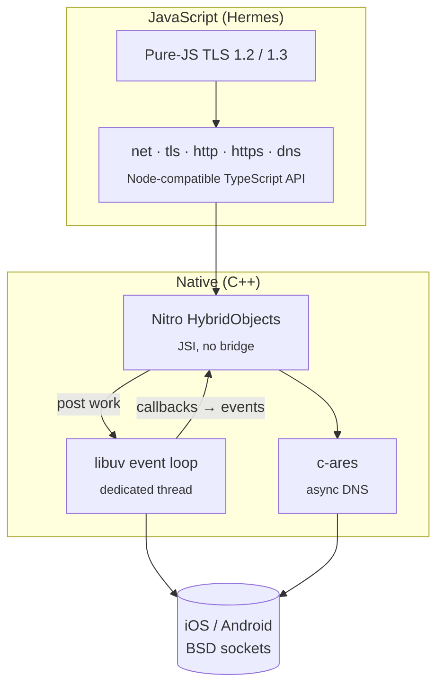

<div align="center">

# react-native-nitro-node

**Node.js core modules for React Native, running on a real libuv event loop.**

`fs` · `net` · `tls` · `dns` · `http` · `https` · `buffer` · `os` · `path` · `process`

[](https://www.npmjs.com/package/react-native-nitro-node)
[](./LICENSE)


</div>

---

Write networking and file system code for React Native the way you would for Node.js: open raw TCP sockets, run an HTTP server on the device, resolve DNS names, or read and write files. The APIs are the ones you already know from Node.

```ts
import net from 'react-native-nitro-node/net';

const server = net.createServer((socket) => {
  socket.write('hello from your phone 👋\n');
  socket.pipe(socket); // echo
});

server.listen(8080, '0.0.0.0', () => {
  console.log('listening on', server.address());
});
```

Underneath is **[libuv](https://libuv.org)**, the same C library behind Node.js's own event loop. The library compiles it into your app and exposes it to JavaScript through **[Nitro Modules](https://nitro.margelo.com)**, with direct JSI bindings and no bridge.

## ✨ Features

- 🔌 **Real TCP sockets and servers:** `net.Socket` and `net.Server` are backed by libuv `uv_tcp_t` handles, not by a WebSocket or a platform HTTP stack.
- 🌐 **HTTP client and server:** an `http` module with streaming bodies, chunked encoding, keep-alive and upgrade/CONNECT events.
- 🔒 **TLS client:** TLS 1.2 and 1.3 sockets and `https` requests, built on a pure-JavaScript TLS stack over the native TCP socket. *(Read the [security note](#-security-note) first.)*
- 📁 **File system:** `fs` with files, file descriptors, directories and `statfs`, in callback and `*Sync` forms. Reads and writes run off the JS thread.
- 🧭 **Native DNS:** `dns.lookup` and `dns.resolve*` are powered by **[c-ares](https://c-ares.org)**, which Node also uses.
- 🧵 **Off the JS thread:** all I/O runs on a dedicated libuv loop thread. Results are delivered back to JavaScript as events.
- 📦 **Node-style imports:** every module supports both `import net from '…/net'` and `import { connect } from '…/net'`.
- 🟦 **TypeScript first:** written in TypeScript, with typed event maps (`socket.on('data', (buf) => …)` knows `buf` is a `Buffer`).
- 🧰 **Node-compatible errors:** errors carry Node's `code`, `errno` and `syscall` fields (`ECONNREFUSED`, `ENOTFOUND`, …), mapped from libuv and c-ares.

## 📦 Installation

```sh
npm install react-native-nitro-node react-native-nitro-modules
# or
yarn add react-native-nitro-node react-native-nitro-modules
```

For `tls` and `https`, also install the TLS stack and a source of secure randomness:

```sh
yarn add @reclaimprotocol/tls react-native-get-random-values
```

```ts
// index.js: must run before anything else
import 'react-native-get-random-values';
```

Then install the native code:

```sh
cd ios && pod install
```

Android needs no extra steps; autolinking picks the library up.

> [!NOTE]
> The library contains native code, so it does not work in Expo Go. Use a [development build](https://docs.expo.dev/develop/development-builds/introduction/) instead.

### Requirements

| | Minimum |
|---|---|
| React Native | New Architecture |
| `react-native-nitro-modules` | 0.35 |
| iOS | React Native's minimum |
| Android | API 23 (Android 6.0) |

## 🚀 Usage

Each module has its own entry point, like Node's built-ins:

```ts
import fs from 'react-native-nitro-node/fs';
import net from 'react-native-nitro-node/net';
import tls from 'react-native-nitro-node/tls';
import dns from 'react-native-nitro-node/dns';
import http from 'react-native-nitro-node/http';
import https from 'react-native-nitro-node/https';
import os from 'react-native-nitro-node/os';
import path from 'react-native-nitro-node/path';
import process from 'react-native-nitro-node/process';
import { Buffer } from 'react-native-nitro-node/buffer';

// Named imports work too:
import { createServer, Socket } from 'react-native-nitro-node/net';
import { lookup } from 'react-native-nitro-node/dns';
import { readFileSync } from 'react-native-nitro-node/fs';
```

Types that several modules share live at the root:

```ts
import type { ErrnoException } from 'react-native-nitro-node';
```

### File system

```ts
import fs from 'react-native-nitro-node/fs';
import os from 'react-native-nitro-node/os';
import { Buffer } from 'react-native-nitro-node/buffer';

// tmpdir() for scratch files; for files that must persist, a folder inside
// os.homedir(), e.g. `${os.homedir()}/Documents` on iOS or `${os.homedir()}/files` on Android
const dir = os.tmpdir();

fs.mkdirSync(`${dir}/notes`, { recursive: true });
fs.writeFileSync(`${dir}/notes/today.txt`, 'Buy milk\n');
fs.appendFileSync(`${dir}/notes/today.txt`, 'Call mom\n');

fs.readFile(`${dir}/notes/today.txt`, 'utf8', (err, text) => {
  if (err) return console.error(err.code); // e.g. 'ENOENT'
  console.log(text);
});

console.log(fs.readdirSync(`${dir}/notes`)); // ['today.txt']

// File descriptors, with explicit positions
const fd = fs.openSync(`${dir}/data.bin`, 'w+');
fs.writeSync(fd, Buffer.from([1, 2, 3, 4]));
const head = Buffer.alloc(2);
fs.readSync(fd, head, 0, 2, 0); // <Buffer 01 02>
fs.closeSync(fd);
```

### TCP client

```ts
import net from 'react-native-nitro-node/net';

const socket = net.connect({ host: 'example.com', port: 80 }, () => {
  socket.write('GET / HTTP/1.1\r\nHost: example.com\r\nConnection: close\r\n\r\n');
});

socket.setEncoding('utf8');
socket.on('data', (chunk) => console.log(chunk));
socket.on('end', () => console.log('server closed the connection'));
socket.on('error', (err) => console.error(err.code, err.message)); // e.g. ECONNREFUSED
```

When a host has both IPv4 and IPv6 addresses, `connect` tries each address in turn, like Node's `autoSelectFamily`.

### HTTP server on the device

```ts
import http from 'react-native-nitro-node/http';

const server = http.createServer((req, res) => {
  res.writeHead(200, { 'Content-Type': 'application/json' });
  res.end(JSON.stringify({ method: req.method, url: req.url }));
});

server.listen(3000, '0.0.0.0');
```

### HTTP and HTTPS requests

```ts
import https from 'react-native-nitro-node/https';

https.get('https://example.com/', (res) => {
  console.log(res.statusCode, res.headers['content-type']);

  let body = '';
  res.setEncoding('utf8');
  res.on('data', (chunk) => (body += chunk));
  res.on('end', () => console.log(body.length, 'characters'));
});
```

```ts
import http from 'react-native-nitro-node/http';

const req = http.request(
  { host: 'httpbin.org', path: '/post', method: 'POST', headers: { 'Content-Type': 'application/json' } },
  (res) => res.pipe(myWritable),
);
req.end(JSON.stringify({ hello: 'world' }));
```

### TLS sockets

```ts
import tls from 'react-native-nitro-node/tls';

const socket = tls.connect(443, 'example.com', () => {
  console.log('handshake complete');
  socket.write('GET / HTTP/1.1\r\nHost: example.com\r\nConnection: close\r\n\r\n');
});

socket.on('data', (data) => console.log(data.toString()));
```

### DNS

```ts
import dns from 'react-native-nitro-node/dns';

dns.lookup('example.com', { all: true }, (err, addresses) => {
  // [{ address: '93.184.215.14', family: 4 }, { address: '2606:2800:…', family: 6 }]
});

dns.resolve4('example.com', (err, addresses) => {
  // ['93.184.215.14']
});

// Not part of Node: give queries a deadline, in milliseconds.
dns.setDefaultTimeout(5000);
```

### Errors

Errors look like Node's, so you can reuse the same error-handling code:

```ts
socket.on('error', (err) => {
  if (err.code === 'ECONNREFUSED') retryLater();
});

dns.lookup('nope.invalid', (err) => {
  err?.code; // 'ENOTFOUND'
  err?.syscall; // 'getaddrinfo'
});
```

## 🧩 Node.js API compatibility

✅ supported · 🟡 partial · ❌ not yet

### `fs`

| API | Status | Notes |
|---|:---:|---|
| `readFile` / `writeFile` / `appendFile` (+ `Sync`) | ✅ | `encoding`, `flag`, `mode`; strings or any `ArrayBufferView`. Like Node, `readFile` refuses files over 2 GiB (`ERR_FS_FILE_TOO_LARGE`) |
| `open` / `close` / `read` / `write` / `ftruncate` (+ `Sync`) | ✅ | Every Node string flag (`'r'`, `'w+'`, `'ax'`, …); `position: null` uses the file offset. 64-bit positions on every platform and ABI, so files past 2 GiB work |
| `mkdir` / `readdir` / `rmdir` / `rm` / `unlink` (+ `Sync`) | ✅ | `mkdir({ recursive })`, `rm({ recursive, force })` |
| `access` / `exists` / `existsSync` | ✅ | |
| `statfs` (+ `Sync`) | ✅ | |
| `constants` | ✅ | The platform's real values; constants a platform lacks are left out |
| `stat` / `lstat` / `fstat` | ❌ | Planned |
| `readdir({ withFileTypes })` / `Dirent` | ❌ | Planned |
| `fs.promises` | ❌ | Planned |
| `createReadStream` / `createWriteStream` | ❌ | Planned |
| `rename`, `copyFile`, `symlink`, `chmod`, `watch`, … | ❌ | Planned |

### `net`

| API | Status | Notes |
|---|:---:|---|
| `net.connect()` / `net.createConnection()` | ✅ | `port`, `host`, `family`, `lookup`, `noDelay`, `keepAlive`, `timeout`, `autoSelectFamilyAttemptTimeout` |
| `net.createServer()` | ✅ | `allowHalfOpen`, `pauseOnConnect`, `noDelay`, `keepAlive` |
| `net.Socket` | ✅ | A full `stream.Duplex`: `write`, `end`, `pipe`, `pause`/`resume`, `setEncoding`, `setTimeout`, `setNoDelay`, `setKeepAlive`, `address`, `destroy`, `readyState`, `ref`/`unref`, … |
| `net.Server` | ✅ | `listen`, `close`, `address`, `getConnections` |
| `net.isIP()` / `isIPv4()` / `isIPv6()` | ✅ | |
| Events | ✅ | `connect`, `ready`, `lookup`, `data`, `drain`, `end`, `timeout`, `error`, `close`, `connection`, `listening` |
| IPC / Unix domain sockets | ❌ | |
| `net.BlockList`, `net.SocketAddress` | ❌ | |

### `tls`

| API | Status | Notes |
|---|:---:|---|
| `tls.connect()` | 🟡 | `host` and `port` only. TLS 1.2 and 1.3 with modern AEAD cipher suites. **No certificate verification yet.** |
| `tls.TLSSocket` | 🟡 | Client side; emits `secureConnect` |
| `tls.createServer()` | ❌ | Planned |
| `servername`, `ca`, `cert`, `key`, `rejectUnauthorized`, ALPN | ❌ | Planned |

### `http`

| API | Status | Notes |
|---|:---:|---|
| `http.createServer()` | ✅ | `keepAliveTimeout`, `requestTimeout`, `headersTimeout`, `maxHeaderSize` |
| `http.request()` / `http.get()` | ✅ | URL strings, `URL` objects or options; `auth`, `timeout`, `lookup`, `family` |
| `IncomingMessage` / `ServerResponse` / `ClientRequest` | ✅ | Streaming bodies, chunked transfer encoding, header helpers |
| Server events | ✅ | `request`, `connection`, `upgrade`, `connect`, `checkContinue`, `clientError`, … |
| `http.STATUS_CODES`, `http.METHODS` | ✅ | |
| `http.Agent` | 🟡 | Accepted for compatibility; each request currently uses its own connection |

### `https`

| API | Status | Notes |
|---|:---:|---|
| `https.request()` / `https.get()` | 🟡 | Same as `http`, over `tls` (so the same certificate caveat applies) |
| `https.createServer()` | ❌ | Waits on `tls.createServer()` |

### `dns`

| API | Status | Notes |
|---|:---:|---|
| `dns.lookup()` | ✅ | `family`, `all`, plus a `timeout` option |
| `dns.resolve()` / `resolve4()` / `resolve6()` | ✅ | A and AAAA records, via c-ares |
| Error code constants (`dns.NOTFOUND`, …) | ✅ | |
| `dns.promises` | ❌ | Planned |
| `resolveMx`, `resolveTxt`, `resolveSrv`, `reverse`, … | ❌ | Planned |

### `buffer`, `os`, `path`, `process`

| API | Status | Notes |
|---|:---:|---|
| `buffer.Buffer` | ✅ | Re-exports the [`buffer`](https://www.npmjs.com/package/buffer) package |
| `os.tmpdir()` / `os.homedir()` | ✅ | The app's own folders: the tmp directory and sandbox on iOS, the cache and data directories on Android |
| `os.EOL` | ✅ | |
| Rest of `os` (`platform`, `cpus`, `networkInterfaces`, …) | ❌ | |
| `path` | ✅ | The full POSIX implementation: `join`, `resolve`, `normalize`, `relative`, `dirname`, `basename`, `extname`, `isAbsolute`, `sep`, `delimiter`, `posix` |
| `process.nextTick` | ✅ | |

## 🏗️ How it works



- **One libuv loop, one thread.** A single `uv_loop_t` runs on its own thread for the whole life of the process. JavaScript calls post work to that thread, and libuv callbacks reach JavaScript as events. The JS thread never blocks on I/O.
- **Nitro Modules** generate the C++ ↔ JS bindings, so every call goes straight through JSI with no serialization over a bridge.
- **c-ares** performs DNS resolution asynchronously. On Android it's initialized with the system's DNS servers from `ConnectivityManager`.
- **fs** calls go straight to POSIX. The short ones run on the JS thread, inside a `setImmediate` for the callback forms; reads and writes run on Nitro's thread pool.
- **TLS** runs in JavaScript ([`@reclaimprotocol/tls`](https://github.com/reclaimprotocol/tls)) on top of the native TCP socket. That keeps the native side small and the same on every platform.

## 🔐 Security note

> [!WARNING]
> **TLS certificates are not verified yet.** `tls.connect()` and `https.request()` encrypt traffic, but they do not check that the server's certificate is valid or matches the host name. That leaves connections open to man-in-the-middle attacks. Don't use them for sensitive data until certificate verification ships (it's at the top of the [roadmap](#️-roadmap)).

## 🗺️ Roadmap

### Next up
- [ ] **TLS certificate verification** against the platform trust store, with `rejectUnauthorized`, `ca` and `servername` (SNI)
- [ ] `tls.createServer()` and `https.createServer()`
- [ ] ALPN negotiation
- [ ] `http.Agent` with connection pooling and keep-alive reuse
- [ ] `dns.promises` and `fs.promises`
- [ ] `fs.stat` / `lstat` / `fstat` with `Stats`, and `readdir({ withFileTypes })`
- [ ] `fs` streams: `createReadStream` and `createWriteStream`

### Later
- [ ] More DNS record types: `resolveMx`, `resolveTxt`, `resolveSrv`, `resolveCname`, `resolveNs`, `reverse`
- [ ] `dgram`: UDP sockets on libuv
- [ ] Unix domain sockets for `net`
- [ ] `events`, `stream`, `url` and `util` entry points, for a fuller drop-in `node:*` replacement
- [ ] A Metro resolver preset that maps `node:net`, `net`, `http`, … to this library, so existing npm packages work without changes

### Done
- [x] `net`: TCP client and server on libuv
- [x] `dns`: `lookup` and `resolve4`/`resolve6` on c-ares
- [x] `http`: client and server
- [x] `tls` / `https`: TLS 1.2 and 1.3 client
- [x] Node-compatible error objects (`code`, `errno`, `syscall`)
- [x] `fs`: files, file descriptors, directories and `statfs`
- [x] `buffer`, `os` (`tmpdir`, `homedir`), `path` and `process` helpers
- [x] Per-module subpath imports with default and named exports

Have a use case that's missing? [Open an issue](https://github.com/gmanole01/react-native-nitro-node/issues).

## 🧪 Example app

The [`example/`](./example) app runs the library's test suites (`net`, `dns`, `http`, `tls`, `fs`, memory and GC) on a device or simulator:

```sh
yarn
cd example
yarn ios      # or: yarn android
```

## 🤝 Contributing

Contributions are welcome. After changing the native specs in `src/native/specs/`, regenerate the bindings:

```sh
yarn nitrogen
```

Then rebuild the example app to try your change.

## 🙏 Acknowledgements

- [libuv](https://libuv.org): the event loop at the heart of Node.js, and of this library
- [c-ares](https://c-ares.org): asynchronous DNS resolution
- [Nitro Modules](https://nitro.margelo.com) by Margelo: the fastest way to build native modules for React Native
- [@reclaimprotocol/tls](https://github.com/reclaimprotocol/tls): the TLS 1.2/1.3 implementation in TypeScript
- [Node.js](https://nodejs.org): for the APIs this library follows

## 📄 License

[MIT](./LICENSE) © George Manole
